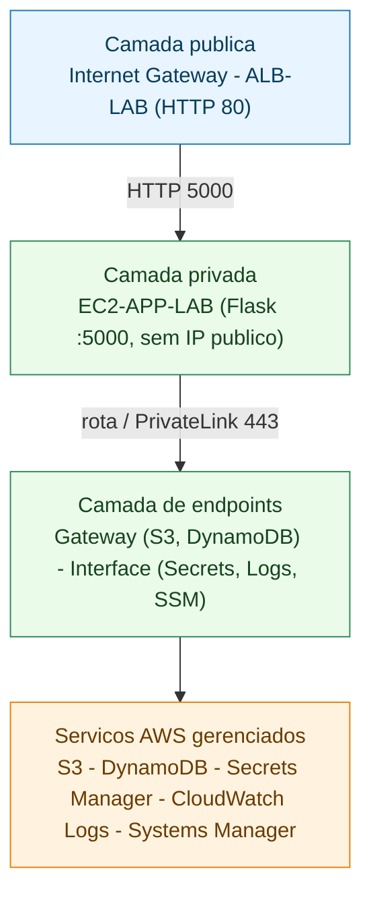
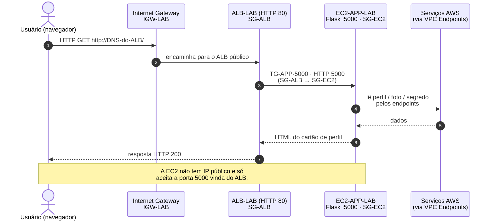
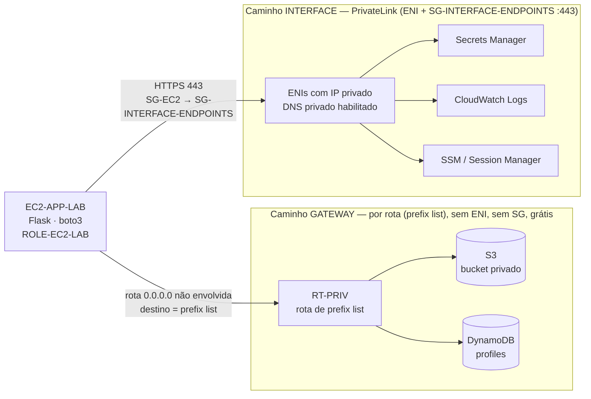
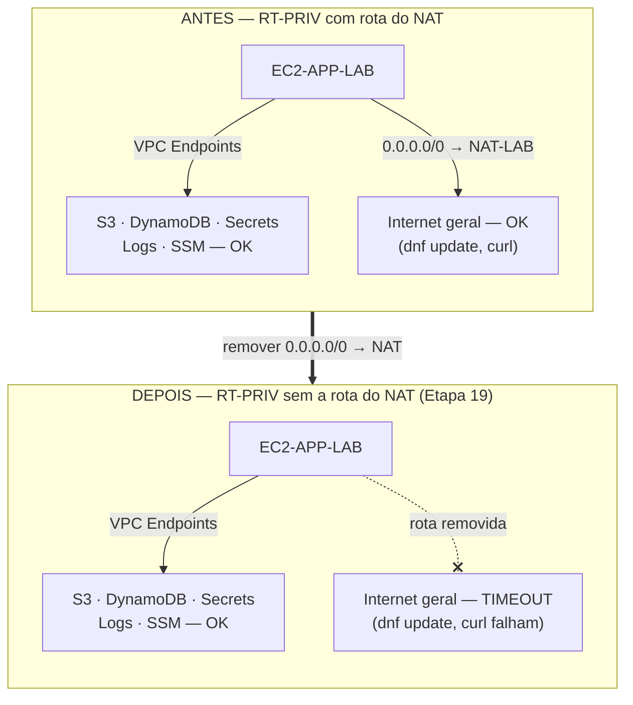
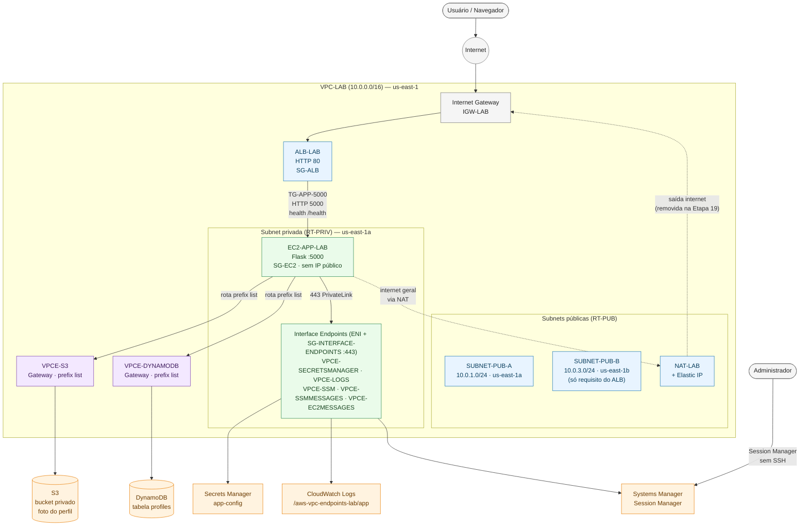

# Arquitetura do Laboratório — `ARQUITETURA.md`

Este documento descreve **exclusivamente a arquitetura que já existe** no laboratório **AWS VPC Endpoints**, na região **`us-east-1`**. Nenhum componente aqui descrito é hipotético: todos correspondem aos recursos criados manualmente no Console AWS (ver [`IMPLANTACAO.md`](./IMPLANTACAO.md)) e ao código da aplicação (`app/`).

> O passo a passo de criação está em [`IMPLANTACAO.md`](./IMPLANTACAO.md). A visão geral do projeto está em [`README.md`](./README.md).

---

## 1. Objetivo da arquitetura

Demonstrar, na prática, a **diferença entre Gateway VPC Endpoints e Interface VPC Endpoints**, usando uma aplicação Flask simples (cartão de perfil) hospedada em uma **única EC2 privada**, exposta à internet apenas por um **Application Load Balancer (ALB) público**.

O ponto central do laboratório é o experimento da Etapa 19 do `IMPLANTACAO.md`: ao remover a rota `0.0.0.0/0 -> NAT-LAB` da route table privada, a aplicação **continua funcionando** por meio dos VPC Endpoints (S3, DynamoDB, Secrets Manager, CloudWatch Logs e SSM/Session Manager), enquanto a saída geral para a internet deixa de existir.

Características de escopo:

- **AZ única** para a aplicação (uma única EC2 privada em `us-east-1a`).
- A **segunda subnet pública** (`SUBNET-PUB-B`, em `us-east-1b`) existe **apenas** para satisfazer o requisito do ALB de usar duas Availability Zones distintas. Não hospeda recursos de aplicação.
- **Sem alta disponibilidade**, sem Terraform/CloudFormation, sem HTTPS/ACM, sem SSH/bastion.

Em uma visão de camadas, o laboratório se organiza assim:

---

## 2. Componentes utilizados

| Componente | Nome / Identificação | Função no laboratório |
|------------|----------------------|-----------------------|
| VPC | `VPC-LAB` (`10.0.0.0/16`) | Rede isolada do laboratório |
| Subnet pública A | `SUBNET-PUB-A` (`10.0.1.0/24`, `us-east-1a`) | NAT Gateway + ALB (AZ principal) |
| Subnet privada | `SUBNET-PRIV` (`10.0.2.0/24`, `us-east-1a`) | EC2 + Interface Endpoints |
| Subnet pública B | `SUBNET-PUB-B` (`10.0.3.0/24`, `us-east-1b`) | Apenas requisito de 2 AZs do ALB |
| Internet Gateway | `IGW-LAB` | Entrada/saída de internet das subnets públicas |
| Route table pública | `RT-PUB` | `0.0.0.0/0 -> IGW-LAB` |
| Route table privada | `RT-PRIV` | `0.0.0.0/0 -> NAT-LAB` + rotas de prefix list dos Gateway Endpoints |
| NAT Gateway | `NAT-LAB` (+ Elastic IP) | Saída de internet da subnet privada (removido no experimento) |
| Application Load Balancer | `ALB-LAB` (HTTP 80) | Único ponto de entrada público |
| Target Group | `TG-APP-5000` (HTTP 5000, health `/health`) | Encaminha ao Flask na EC2 |
| EC2 | `EC2-APP-LAB` (Amazon Linux 2023, sem IP público) | Servidor da aplicação Flask |
| Security Group do ALB | `SG-ALB` | Inbound 80 público; outbound 5000 para `SG-EC2` |
| Security Group da EC2 | `SG-EC2` | Inbound 5000 de `SG-ALB`; sem SSH 22; outbound 443 |
| Security Group dos Interface Endpoints | `SG-INTERFACE-ENDPOINTS` | Inbound 443 apenas de `SG-EC2` |
| IAM Role | `ROLE-EC2-LAB` (+ Instance Profile) | Menor privilégio para S3, DynamoDB, Secrets, Logs e SSM |
| Bucket S3 | `BUCKET_NAME` (privado) | Foto do perfil (`profiles/profile-001/avatar.jpg`) |
| Tabela DynamoDB | `profiles` (PK `profileId`) | Dados do perfil (inclui `photoKey`, nunca a imagem) |
| Segredo Secrets Manager | `aws-vpc-endpoints-lab/app-config` | `APP_NAME` / `APP_ENV` exibidos pela app |
| Log group CloudWatch | `/aws-vpc-endpoints-lab/app` (stream `app-events`) | Eventos de domínio da aplicação |
| Gateway Endpoints | `VPCE-S3`, `VPCE-DYNAMODB` | Acesso a S3 e DynamoDB por rota (prefix list) |
| Interface Endpoints | `VPCE-SECRETSMANAGER`, `VPCE-LOGS`, `VPCE-SSM`, `VPCE-SSMMESSAGES`, `VPCE-EC2MESSAGES` | Acesso via ENI/PrivateLink na porta 443 |

### VPC e subnets

- **VPC** `VPC-LAB` com CIDR `10.0.0.0/16`.
- **`SUBNET-PUB-A`** (`10.0.1.0/24`, `us-east-1a`): hospeda o **NAT Gateway** e participa do **ALB**. Associada à `RT-PUB`.
- **`SUBNET-PRIV`** (`10.0.2.0/24`, `us-east-1a`): hospeda a **EC2** e as **ENIs dos Interface Endpoints**. Associada à `RT-PRIV`.
- **`SUBNET-PUB-B`** (`10.0.3.0/24`, `us-east-1b`): participa **apenas** do ALB (segunda AZ exigida). Associada à `RT-PUB`.

### ALB

- `ALB-LAB` **internet-facing**, nas duas subnets públicas (`us-east-1a` + `us-east-1b`).
- Listener **HTTP 80** → Target Group `TG-APP-5000` (**HTTP 5000**, health check `/health`).
- Protegido pelo `SG-ALB` (inbound 80 de `0.0.0.0/0`).

### NAT Gateway

- `NAT-LAB` na `SUBNET-PUB-A`, com Elastic IP.
- Fornece **saída** de internet à subnet privada (instalar pacotes, registro inicial do SSM Agent).
- A rota `0.0.0.0/0 -> NAT-LAB` em `RT-PRIV` é **removida temporariamente** no experimento central (Etapa 19) e depois restaurada.

### EC2 privada

- `EC2-APP-LAB` com **Amazon Linux 2023**, **sem IP público**, na `SUBNET-PRIV`.
- Roda o Flask na porta **5000** (`host 0.0.0.0`).
- Credenciais apenas via **IAM Role** (`ROLE-EC2-LAB`), sem chaves embutidas.
- Acesso administrativo **somente por Session Manager** (sem SSH 22).

### Security Groups

| SG | Inbound | Outbound |
|----|---------|----------|
| `SG-ALB` | HTTP 80 de `0.0.0.0/0` | TCP 5000 para `SG-EC2` |
| `SG-EC2` | TCP 5000 apenas de `SG-ALB` (sem SSH 22) | TCP 443 para `SG-INTERFACE-ENDPOINTS` (e 443 geral enquanto o NAT existir) |
| `SG-INTERFACE-ENDPOINTS` | TCP 443 apenas de `SG-EC2` | padrão |

> **Ponto didático:** os **Interface Endpoints usam Security Group** (`SG-INTERFACE-ENDPOINTS`, porta 443). Os **Gateway Endpoints (S3 e DynamoDB) não usam Security Group** — são controlados por rota (prefix list) e Endpoint Policy.

### IAM Role

- `ROLE-EC2-LAB` com Instance Profile e **menor privilégio**:
  - S3: `GetObject`/`PutObject`/`DeleteObject` restrito ao bucket do lab.
  - DynamoDB: `GetItem`/`PutItem`/`UpdateItem` restrito à tabela `profiles`.
  - Secrets Manager: `GetSecretValue` restrito ao segredo da app.
  - CloudWatch Logs: `CreateLogGroup`/`CreateLogStream`/`PutLogEvents` no log group do lab.
  - SSM: política gerenciada `AmazonSSMManagedInstanceCore` (Session Manager).

### S3

- Bucket **privado** (Block Public Access habilitado). Guarda apenas a foto (`profiles/profile-001/avatar.jpg`).
- A foto é entregue ao navegador **por proxy** da aplicação (`GET /photo`), garantindo que todo acesso ao S3 saia da EC2 pelo **Gateway Endpoint**.

### DynamoDB

- Tabela `profiles`, partition key `profileId` (String).
- Guarda os dados do perfil e a referência `photoKey` — **nunca** a imagem binária.

### Secrets Manager

- Segredo `aws-vpc-endpoints-lab/app-config` com `{"APP_NAME":"AWS Profile Lab","APP_ENV":"lab"}`.
- A app lê `APP_NAME` e o exibe na página (demonstra Interface Endpoint).

### CloudWatch Logs

- Log group `/aws-vpc-endpoints-lab/app`, stream `app-events`.
- Eventos de domínio: `APPLICATION_STARTED`, `PROFILE_CREATED`, `PROFILE_UPDATED`, `PHOTO_UPLOADED`, `PHOTO_CHANGED`, `ERROR`.
- Emissão **tolerante a falhas** (não bloqueia a aplicação).

### Gateway Endpoints

- `VPCE-S3` e `VPCE-DYNAMODB`, associados à `RT-PRIV`.
- Funcionam adicionando uma rota para a **prefix list** gerenciada da AWS. **Sem ENI, sem IP próprio, sem Security Group.** Gratuitos.

### Interface Endpoints / PrivateLink

- `VPCE-SECRETSMANAGER`, `VPCE-LOGS`, `VPCE-SSM`, `VPCE-SSMMESSAGES`, `VPCE-EC2MESSAGES`, na `SUBNET-PRIV`.
- Cada um cria uma **ENI com IP privado** via **AWS PrivateLink**, com **DNS privado** habilitado e Security Group `SG-INTERFACE-ENDPOINTS` liberando a porta **443**.

### Session Manager

- Acesso administrativo à EC2 **sem SSH** e **sem bastion**, usando os três Interface Endpoints do SSM (`ssm`, `ssmmessages`, `ec2messages`) e a política `AmazonSSMManagedInstanceCore`.

---

## 3. Tabela: serviço, tipo de endpoint e finalidade

| Serviço AWS | Tipo de endpoint | Nome do endpoint | Usa SG? | Finalidade no laboratório |
|-------------|------------------|------------------|---------|---------------------------|
| S3 | **Gateway** | `VPCE-S3` | Não (rota/prefix list) | Armazenar e servir a foto do perfil |
| DynamoDB | **Gateway** | `VPCE-DYNAMODB` | Não (rota/prefix list) | Persistir os dados do perfil |
| Secrets Manager | **Interface** (PrivateLink) | `VPCE-SECRETSMANAGER` | Sim (443) | Ler `APP_NAME`/`APP_ENV` |
| CloudWatch Logs | **Interface** (PrivateLink) | `VPCE-LOGS` | Sim (443) | Emitir eventos de domínio |
| Systems Manager | **Interface** (PrivateLink) | `VPCE-SSM` | Sim (443) | Session Manager (plano de controle) |
| SSM Messages | **Interface** (PrivateLink) | `VPCE-SSMMESSAGES` | Sim (443) | Session Manager (canal de mensagens) |
| EC2 Messages | **Interface** (PrivateLink) | `VPCE-EC2MESSAGES` | Sim (443) | Session Manager (registro do agente) |

---

## 4. Fluxo de acesso do usuário

1. O usuário abre `http://<DNS-do-ALB>/` no navegador.
2. A requisição chega ao **Internet Gateway** (`IGW-LAB`) e ao **ALB público** (`ALB-LAB`), nas subnets públicas.
3. O ALB (via `SG-ALB`) encaminha o tráfego HTTP 80 para a porta **5000** da EC2 (`TG-APP-5000`), atravessando a fronteira `SG-ALB -> SG-EC2`.
4. A **EC2 privada** (`EC2-APP-LAB`) processa a requisição no Flask e responde pelo mesmo caminho.
5. A EC2 **nunca** é acessível diretamente da internet: não tem IP público e só aceita a porta 5000 vinda do `SG-ALB`.

---

## 5. Fluxo da aplicação para cada serviço

A partir da EC2 privada, o `boto3` usa a `ROLE-EC2-LAB` e alcança cada serviço pelo endpoint correspondente:

- **S3** (`GET /photo`, upload no `POST /save`): sai pela `RT-PRIV` → rota de **prefix list** do `VPCE-S3` (Gateway) → S3. A imagem nunca é pública; é entregue por proxy pela app.
- **DynamoDB** (`get`/`put`/`update` do perfil): sai pela `RT-PRIV` → **prefix list** do `VPCE-DYNAMODB` (Gateway) → DynamoDB.
- **Secrets Manager** (leitura de `APP_NAME`): resolve o DNS privado para a **ENI** do `VPCE-SECRETSMANAGER`, atravessa `SG-EC2 -> SG-INTERFACE-ENDPOINTS` na porta 443 → PrivateLink → Secrets Manager.
- **CloudWatch Logs** (emissão de eventos): mesma lógica via **ENI** do `VPCE-LOGS` na porta 443.
- **Session Manager** (acesso admin): usa as **ENIs** de `VPCE-SSM`, `VPCE-SSMMESSAGES` e `VPCE-EC2MESSAGES` na porta 443.

O diagrama abaixo destaca o **ponto didático central**: os dois caminhos de endpoint são tecnicamente diferentes.

---

## 6. Diferença de caminho: com NAT e sem NAT

A tabela resume o comportamento; o diagrama mostra visualmente os dois estados da `RT-PRIV`.

| Caminho | Com rota `0.0.0.0/0 -> NAT-LAB` em `RT-PRIV` | Sem a rota (experimento da Etapa 19) |
|---------|----------------------------------------------|--------------------------------------|
| S3 e DynamoDB (Gateway Endpoints) | Funciona (prefix list) | **Funciona** (prefix list, independe do NAT) |
| Secrets Manager, Logs, SSM (Interface Endpoints) | Funciona (PrivateLink 443) | **Funciona** (PrivateLink 443, independe do NAT) |
| Internet geral (ex.: `dnf update`, `curl https://example.com`) | Funciona (sai pelo NAT) | **Falha / timeout** (sem rota para a internet) |

Conclusão do experimento: a aplicação depende apenas dos **VPC Endpoints**, não do NAT. Removida a rota do NAT, o site segue 100% funcional (perfil, foto, logs, Session Manager), mas a saída geral para a internet para de funcionar.

---

## 7. Diagrama geral da arquitetura (Mermaid)

> **Legenda de cores:** azul = camada pública (IGW, ALB, subnets públicas, NAT); verde = camada privada (EC2 e Interface Endpoints); roxo = Gateway Endpoints (acesso por rota); laranja = serviços AWS gerenciados; cinza = atores externos.

> O diagrama representa **somente** componentes já utilizados pelo laboratório. A linha tracejada do NAT indica o caminho de internet geral que é **removido temporariamente** no experimento da Etapa 19 e depois restaurado.
