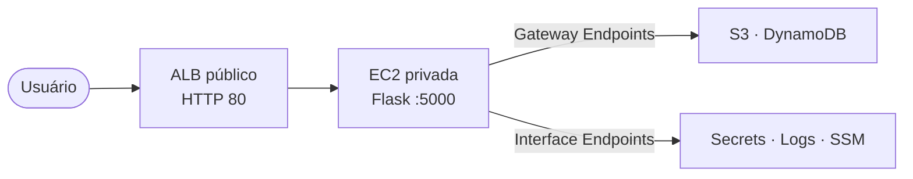

# VPC Endpoints na prática: uma aplicação Flask que acessa a AWS sem passar pela internet

Em muitos ambientes de nuvem, o acesso aos serviços gerenciados da AWS — guardar um arquivo no S3, ler um registro no DynamoDB, buscar uma senha no Secrets Manager — acontece pela internet: o tráfego sai da rede, passa por um NAT Gateway e volta pela porta pública do serviço. Funciona, mas nem sempre é o ideal. Às vezes queremos uma rede fechada, menos custo de NAT ou um caminho privado e auditável até a AWS.

É aí que entram os **VPC Endpoints**. Este laboratório educacional torna a ideia tangível: uma pequena aplicação web, rodando em uma única EC2 **sem acesso direto à internet**, que mesmo assim conversa com S3, DynamoDB, Secrets Manager, CloudWatch Logs e o Systems Manager por caminhos privados. O ponto alto do exercício é desligar a saída de internet da instância e observar que a aplicação **não para de funcionar**.

Toda a infraestrutura é criada manualmente no Console AWS (`us-east-1`), sem Terraform, CloudFormation ou CLI. O passo a passo está em [`IMPLANTACAO.md`](./IMPLANTACAO.md) e a arquitetura detalhada, com diagramas, em [`ARQUITETURA.md`](./ARQUITETURA.md).

## Os dois tipos de VPC Endpoint

O objetivo central é mostrar que existem **dois tipos de VPC Endpoint**, com funcionamento tecnicamente diferente. Essa distinção costuma ser decorada em provas, mas raramente vista acontecendo — aqui ela é o fio condutor do exercício.

| | Gateway Endpoint | Interface Endpoint |
|---|---|---|
| Serviços no lab | S3, DynamoDB | Secrets Manager, CloudWatch Logs, SSM |
| Como funciona | Rota para uma *prefix list* na route table | ENI com IP privado via **PrivateLink** |
| Placa de rede (ENI) | Não | Sim |
| Security Group | Não usa | Usa (porta 443) |
| Custo | Gratuito | Por hora e por volume |

A diferença essencial — **rota** versus **interface de rede** — é o que o laboratório pretende fixar pela experiência direta.

## A aplicação de exemplo

Para dar propósito à infraestrutura, o projeto traz uma aplicação **Flask (Python)** mínima: um cartão de perfil de usuário. É simples de propósito, porque o foco é o caminho de rede até a AWS, não a aplicação em si. Ainda assim, ela exercita cada tipo de endpoint.

Os dados do perfil (nome, e-mail, profissão, cidade, bio, interesses) vão para a tabela `profiles` no **DynamoDB**; a foto vai para um bucket **S3** privado — ambos por Gateway Endpoint. A foto nunca é guardada no DynamoDB: a tabela só armazena uma referência textual (`photoKey`), e a imagem é entregue ao navegador por *proxy* da aplicação (`GET /photo`), garantindo que todo acesso ao S3 passe pelo Gateway Endpoint. Já o nome exibido no topo da página vem de um segredo no **Secrets Manager**, e cada ação relevante gera um evento no **CloudWatch Logs** — os dois por Interface Endpoint.

As rotas são poucas: `GET /` mostra o cartão ou o formulário de criação, `GET /edit` abre a edição, `POST /save` grava, `GET /photo` serve a imagem e `GET /health` responde o health check do balanceador.

## Como as peças se conectam

A EC2 que roda o Flask fica em **subnet privada, sem IP público**, inacessível diretamente da internet. O único ponto de entrada é um **Application Load Balancer (ALB) público** na porta 80, que encaminha para a porta 5000 da aplicação. Os Security Groups reforçam o desenho em camadas: o ALB aceita a internet, a EC2 aceita só o ALB, e os Interface Endpoints aceitam só a EC2.

O ALB exige subnets em **duas Availability Zones**, mesmo que a aplicação use só uma — por isso o guia cria uma segunda subnet pública. Ela existe apenas para esse requisito e não hospeda recursos; a EC2 continua única em uma AZ, e o laboratório **não** vira uma arquitetura de alta disponibilidade.

O acesso administrativo segue a mesma lógica fechada: sem SSH, sem bastion, sem chaves — apenas **Session Manager**, viabilizado pelos Interface Endpoints do SSM. As credenciais da aplicação nunca aparecem em código: a EC2 assume uma **IAM Role** de menor privilégio, restrita ao bucket do lab, à tabela `profiles`, ao segredo e ao log group do projeto.

## O experimento central: desligar a internet

Durante a montagem, a instância tem saída para a internet por um **NAT Gateway**, necessário no início para instalar pacotes e registrar o agente do SSM. O aprendizado vem ao removê-lo: na etapa final, você apaga a rota `0.0.0.0/0 → NAT` da route table privada.

A partir daí, a aplicação continua 100% funcional — cria e edita perfil, troca foto, gera logs e conecta por Session Manager — enquanto comandos como `sudo dnf update` ou `curl -I https://example.com --connect-timeout 5` falham por timeout. O contraste é a lição inteira: a aplicação nunca dependeu da internet para falar com a AWS, sempre usou os VPC Endpoints. Ao final, o guia orienta a restaurar a rota do NAT.

## Configuração e segurança

Quase toda a configuração vive em [`app/config.py`](./app/config.py) e já corresponde aos nomes do guia. O **único valor obrigatório a trocar** é o `BUCKET_NAME`: como nomes de bucket S3 são únicos globalmente, o arquivo traz o placeholder `aws-vpc-endpoints-lab-REPLACE-ME`, que você substitui pelo nome real do seu bucket **antes** de iniciar o Flask (sem isso, foto não sobe nem aparece).

Em segurança, o laboratório segue boas práticas que valem para ambientes reais: sem chaves embutidas (só IAM Role), bucket S3 privado, EC2 sem IP público nem SSH, acesso só por Session Manager e permissões de menor privilégio.

## Estrutura e próximos passos

Na raiz ficam os três documentos: este `README.md` (visão geral), o [`IMPLANTACAO.md`](./IMPLANTACAO.md) (passo a passo no Console) e o [`ARQUITETURA.md`](./ARQUITETURA.md) (descrição técnica e diagramas). Em `app/` está a aplicação: `config.py`, `app.py`, os módulos em `services/` (um por serviço AWS), os templates e os estáticos.

Começando agora, leia a [arquitetura](./ARQUITETURA.md) para formar o modelo mental e siga o [guia de implantação](./IMPLANTACAO.md) do início ao fim — da criação da VPC até o experimento de remoção do NAT.
